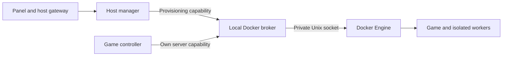

# Docker access and process isolation

New managed-host definitions put Docker authority in a separate local broker.
The host manager and per-game controllers receive scoped broker access instead
of `/var/run/docker.sock`. This is source implementation, not an activated upgrade
of an existing installation.

## Authority and credentials

| Process | Docker access |
| --- | --- |
| Panel / hosted gateway | No daemon socket, broker socket or broker credentials |
| Host manager | Broker socket and read-only host capability; restricted provisioning and owned resource lifecycle |
| Instance controller | Broker socket and only its own read-only capability directory |
| Game / storage / preview workers | No daemon socket or broker credentials |
| Docker broker | Daemon socket; private capability/audit state and transport volumes; no game files mounted |

The broker has no TCP listener or container network. It uses a read-only root
filesystem, drops capabilities, enables no-new-privileges and limits memory,
CPU and processes. It remains **trusted host software**: its daemon socket still
confers Docker-host authority. A broker compromise can affect the host.

Host and instance credentials are separate random values. Private broker state
stores their hashes, instance/game bindings and persistent revocations. The
transport volume has separate `socket`, `host` and `instances/<id>` directories.
Each controller mounts only the socket directory and its own credential directory
read-only, using Docker volume subpaths; it cannot traverse into another
credential directory or the broker state. Host credentials never appear in
instance volumes, controller environment values or remote-host traffic.

Authentication precedes request-body consumption. Requests have a 1 MiB input
limit, bounded output/deadlines, at most four active requests per capability and
32 overall, and a 600-request/minute limit per capability. Invalid credentials,
revoked credentials and malformed paths/methods are refused. Broker configuration
never falls back to a daemon socket if credentials, transport or policy fail.

## Enforced contracts

The broker resolves authority from its own records, never from instance-supplied
fleet IDs, environment variables or manager registry files. Instance Docker
policy executes in the broker process, so modifying controller code cannot
remove it. Public web permissions and exact game/HTTP route checks still apply
before requests reach the controller.

Instance requests are restricted to the declared game and valid game-preview
workers. Container operations use inspected immutable IDs. Workers must match
the owned game image and one private working subpath; host bind mounts, extra
volumes, device/namespace access, alternate networks and general executables are
refused. Preview workers use at most 1 GiB and one CPU each, with at most two per
instance and 256 processes each. RCON exec IDs are issued by the broker capability,
expire, and cannot be started again. The only archive-read endpoint exposes the
installed Factorio map-settings example, preserving world-generation behavior.
The game-specific shutdown policy retains Rust’s graceful unlimited stop timeout
instead of allowing Docker to force-kill it after a generic deadline.

Host provisioning accepts declared game images and the broker's own immutable
runtime image for exact controller/storage-worker entrypoints. It validates
resource names, actual volume ownership/drivers, mount subpaths, published game
ports, actual network ownership and driver,
resource limits and environment bindings. Security settings are generated by the
broker. Arbitrary host paths, volume drivers, container exec, daemon endpoints,
management replacement, image sources and controller access to host credentials
are refused. Storage workers can access only declared fleet/instance storage.
Instance data volumes cannot be deleted through this API.

All container creations share one broker reservation queue. It rechecks aggregate
managed memory against Docker capacity, leaves 2 GiB of headroom, and bounds
managed container and storage-worker counts. This supplements the panel's budget;
other host workloads still need separately planned capacity. Games and controllers
receive process limits and capability drops. These are bounded controls, not a
disk quota, egress policy or protection against every denial of service.

Broker mutations save private started/outcome audit entries, excluding bodies,
credentials and game contents. Initial audit failure prevents submission; a lost
completion record reports uncertainty instead of inviting automatic replay.
Denied reads are recorded; ordinary successful reads do not fill the audit log.
Audit retains the same single-writer, bounded JSON guarantees described in
[the access contract](ACCESS.md), with its store in the private broker volume.

## Existing installations and updates

Existing manifests, identities, accounts, volumes, game images, controller tokens,
world paths and standalone definitions are preserved. Preparation still reuses
an intact existing installation without rewriting it. An installation without
broker configuration retains its historical transport. Those legacy controllers
still have daemon authority; editing these sources does not remove it.

Fresh local, hosted and agent-only definitions use the broker. Startup checks the
selected runtime's broker protocol before starting a fresh stack, so an older
published image cannot silently ignore the new mode. Docker must support volume
subpaths; Compose validates the generated long-syntax mounts before starting.
The relevant mapping is documented in
[Docker Compose's mount implementation](https://github.com/docker/compose/blob/main/pkg/compose/create.go).
Disposable conformance runtimes have been built and tested, as recorded in
[runtime-definition verification](verification/runtime-definitions.md). No runtime
has been published or deployed to an existing installation by this work.

Do not add broker variables to an unconverted registry. The host manager refuses
such a registry before adopting or reconnecting controllers. The pure
`planBrokerUpgrade` helper in `panel/fleet/broker-upgrade.js` accepts supplied
inspection/registry metadata and produces a **review-only** plan. It verifies
standard ownership/storage/network layouts, rejects custom or interrupted
installations, records expected game IDs/images/mount fingerprints and controller
IDs, and excludes secret environment values. It reads no files, calls no engine,
modifies no input and has no apply function.

A future upgrade requires separate authorization and disposable-host acceptance:
start the broker, issue instance capabilities, replace only management services
and controllers with the same instance volumes/networks, verify that game
identities/images/mounts have not changed, then record verified isolation versions.
Existing game processes and worlds must remain untouched. The review plan does
not prove that this operational upgrade has happened or that an older game's
runtime restrictions have changed.

Standalone panel/game updaters retain their existing validation and recovery.
Managed fleets and agents use coordinated management updates; an interrupted old
agent update retains its recovery route. The fixed coordinator is the only new
socket-bearing helper. Broker-mode application and web credentials cannot choose
its commands, mounts, image or paths. Recognized legacy deployments retain their
existing raw-socket authority; this update does not convert their registry or
change game isolation. See [management updates](MANAGEMENT_UPDATES.md) for
portable storage, supported scope and recovery commands.

## Remaining trust boundary

This removes direct daemon access from newly defined managed controllers and
enforces their Docker permissions in another process. It does **not** create a
hostile-tenant VM boundary. Game/mod code still shares the Docker host kernel;
controllers retain authority over their own game data, and host management is
trusted with all instances in its fleet. Broker availability and container-runtime security,
unmanaged host workloads, disk/egress limits and operational credentials remain
part of the deployment trust model.

Mutually untrusted operators/executable workloads should use separately reviewed
hosts or VMs. Real Linux Docker/subpath acceptance, a reviewed existing-installation
upgrade and adversarial disposable-host checks remain necessary before claiming
deployed containment. See [local verification](verification/docker-broker.md).
